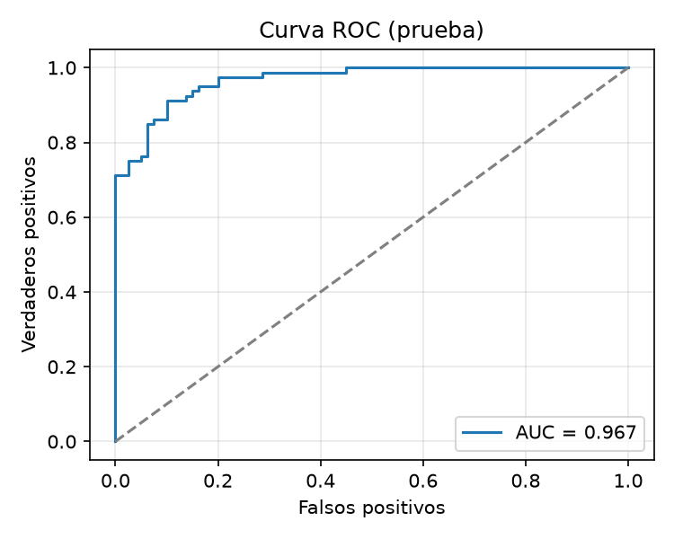
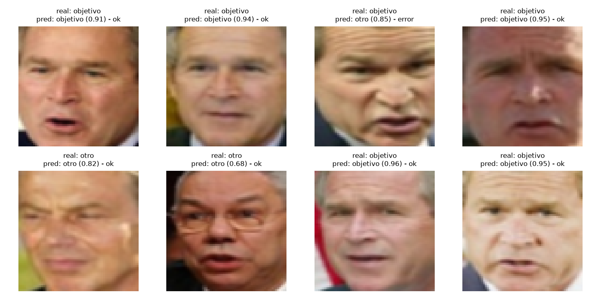

Repositorio: <https://github.com/ErickMeza0102/Tareaa4>

## 1. Objetivo

Entrenar una red neuronal que reconozca "mi rostro" y lo distinga de cualquier
otro rostro. Como un conjunto de fotos personales suele ser pequeño, se usa
**transfer learning**: primero se pre-entrena una CNN con una tarea grande y
relacionada (los 40 atributos faciales de **CelebA**) y después se reutiliza
su parte convolucional como extractor de características para el clasificador
binario final.

El entrenamiento se divide en las tres etapas que pide el documento:

1. **(a)** entrenar la CNN de atributos de CelebA;
2. **(b)** quitar el clasificador, congelar las capas pre-entrenadas y entrenar
   sólo un clasificador nuevo;
3. **(c)** hacer *fine-tuning* de las últimas capas convolucionales.

## 2. Datos

| Conjunto | Uso | Tamaño |
|---|---|---|
| CelebA (subconjunto) | Pre-entrenamiento de atributos | 10 000 imágenes, 64×64, 40 atributos |
| LFW, identidad objetivo | Clase positiva ("mi rostro") | 530 fotos |
| LFW, resto de identidades | Clase negativa | 530 fotos (balanceado) |

Las fotos se redimensionan a 64×64 para que el entrenamiento sea viable en CPU.
Los conjuntos binarios quedan balanceados y separados en
entrenamiento / validación / prueba con 742 / 158 / 160 imágenes.

**Nota sobre "mi rostro".** No se cuentan con fotografías propias, así que la
clase positiva se simula con una **identidad pública de LFW** (la persona con
más fotos del conjunto, *George W. Bush*). El procedimiento es idéntico al que
se seguiría con fotos personales: sólo cambia de dónde salen los positivos.

## 3. Etapa (a): pre-entrenamiento en CelebA

Arquitectura convolucional pequeña (4 bloques `Conv2D` + `BatchNormalization`
+ `MaxPooling`, `GlobalAveragePooling` y una capa densa) con **40 salidas
sigmoide**, una por atributo:

| Bloque | Salida | Parámetros |
|---|---|---|
| Conv 32 + BN + pool | 32×32×32 | 1 024 |
| Conv 64 + BN + pool | 16×16×64 | 18 752 |
| Conv 128 + BN + pool | 8×8×128 | 74 368 |
| Conv 128 + BN + GAP | 128 | 148 096 |
| Densa 256 + Dropout + 40 | 40 | 43 304 |

Total: **285 544 parámetros**, de los cuales **242 240** corresponden a la base
convolucional reutilizada en las etapas siguientes.

Resultado del pre-entrenamiento (mejor época por `val_loss`):

| Métrica | Valor |
|---|---|
| `val_loss` | 0.4523 |
| Exactitud binaria promedio | 0.797 |
| Épocas | 3 (early stopping) |

La exactitud binaria promedio de 0.797 es un valor de referencia: mide el
acierto por atributo y está dominado por los atributos frecuentes (por ejemplo
`No_Beard`, presente en la mayoría de las caras). No significa que la red
reconozca identidades.

## 4. Etapa (b): base congelada + clasificador nuevo

Se carga `conv_base`, se congelan sus pesos (`capa.trainable = False`) y se
agrega:

```
entrada 64×64×3 → conv_base (congelada, 242 240 parámetros)
                → LayerNormalization
                → Dense(128, relu) → Dropout(0.3)
                → Dense(1, sigmoid)
```

Sólo se entrenan **16 897 parámetros**. Se usa `ImageDataGenerator` para
aumentar los datos (rotaciones ±15°, desplazamientos, zoom, volteo horizontal y
cambios de brillo).

Resultado en prueba (umbral elegido en validación):

| Métrica | Valor |
|---|---|
| AUC | 0.578 |
| Exactitud | 0.556 |
| F1 | 0.523 |

La base congelada **no separa identidades**: el AUC queda cerca del azar. El
diagnóstico es claro: las características que produce la base tienen una
desviación estándar media por dimensión de sólo 0.015 y una regresión logística
entrenada sobre ellas alcanza un AUC de 0.56. La red aprendió a describir
*atributos* (sonrisa, lentes, color de pelo), no a distinguir *quién* es la
persona.

## 5. Etapa (c): fine-tuning

### 5.1 El problema de BatchNorm

El primer intento de fine-tuning tampoco aprendía (AUC ≈ 0.43). La causa era
construir el modelo llamando a la base como `base(entradas, training=False)`:
eso deja las capas `BatchNormalization` en modo inferencia de forma permanente,
con las estadísticas calculadas en CelebA. Aunque los pesos convolucionales se
descongelaran, las activaciones seguían normalizadas con medias y varianzas de
otro dominio (CelebA vs. LFW), y el gradiente no lograba adaptar nada.

La corrección consiste en llamar a la base como `base(entradas)`, sin
`training=False`. Así la base hereda el modo de entrenamiento del modelo y
BatchNorm puede recalcular sus estadísticas con las fotos nuevas.

### 5.2 Esquema en dos fases

1. **Calentamiento:** se descongela el último bloque convolucional, con
   BatchNorm congelado y `lr = 1e-3` durante 3 épocas.
2. **Refinamiento:** se descongela toda la base (incluido BatchNorm),
   `lr = 5e-4`, con `ReduceLROnPlateau` y *early stopping* sobre `val_auc`
   (30 épocas como máximo, se ejecutaron las 30).

El umbral de decisión se elige en **validación** maximizando el índice de
Youden (TPR − FPR); se obtiene 0.85 y se aplica al conjunto de prueba.

Resultado en prueba:

| Métrica | Valor |
|---|---|
| AUC | 0.967 |
| Exactitud | 0.888 |
| Precisión | 0.897 |
| Recall | 0.875 |
| F1 | 0.886 |

Matriz de confusión (filas = real, columnas = predicción):

|  | pred: otro | pred: objetivo |
|---|---|---|
| **real: otro** | 72 | 8 |
| **real: objetivo** | 10 | 70 |





## 6. Comparación de las tres etapas

| Modelo | Parámetros entrenables | AUC (prueba) |
|---|---|---|
| (b) Base congelada | 16 897 | 0.578 |
| (c) Fine-tuning | 258 433 | 0.967 |
| Referencia: misma CNN desde cero | 285 000 | 0.829 |

El fine-tuning con pesos heredados supera claramente al mismo modelo entrenado
desde cero, que es justamente el argumento a favor del transfer learning: la
red no parte de ruido, sino de filtros que ya detectan bordes, texturas y
formas de rostro.

## 7. Discusión

- **Transferencia de atributos a identidad.** Un pre-entrenamiento de sólo 3
  épocas sobre 10 000 imágenes produce características demasiado pobres para
  separar identidades. Es esperable: los atributos son propiedades globales y
  compartidas por miles de personas, mientras que la identidad exige detalles
  finos. Por eso la etapa (b), que sólo entrena el clasificador, se queda en el
  azar.
- **Cambio de dominio.** CelebA y LFW tienen encuadres, iluminación y
  resolución distintos. Las estadísticas de BatchNorm aprendidas en CelebA no
  sirven en LFW; adaptarlas es imprescindible.
- **Costo del fine-tuning.** Descongelar toda la base multiplica los
  parámetros entrenables y el tiempo por época, pero es lo que convierte una
  base mediocre en un buen clasificador con sólo ~740 imágenes de entrenamiento.

## 8. Conclusiones

1. El pipeline completo de transfer learning (pre-entrenar → congelar →
   clasificador → fine-tuning) quedó implementado y reproducible.
2. Congelar la base no basta cuando la tarea objetivo es distinta de la tarea
   de pre-entrenamiento: hace falta fine-tuning.
3. El detalle de `training=False` en BatchNorm puede arruinar silenciosamente
   el fine-tuning; hay que dejar que la base herede el modo de entrenamiento.
4. Con ~740 imágenes y una CNN pequeña se alcanza un AUC de 0.967 en prueba,
   superior al 0.829 de entrenar la misma red desde cero.

## 9. Reproducibilidad

```bash
pip install -r requirements.txt
python preparar_datos.py        # descarga CelebA y LFW (data/, no se versiona)
python entrenar_celeba.py       # etapa (a)
python clasificador_transfer.py # etapa (b)
python fine_tuning.py           # etapa (c)
```

Los datos quedan en `data/` (ignorado por Git por tamaño). Los modelos,
gráficas, historiales y métricas sí se versionan en `modelos/`, `plots/` y
`resultados/`.
